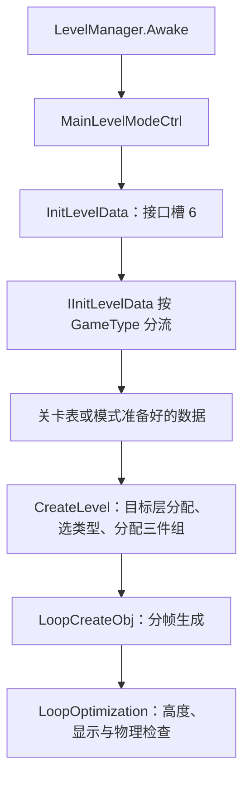

# 09 各模式调用链

2026-10-24 续查见[第 13 章](13-拆分模式调用链续查.md)：第二 WASM 已展开长桌 InitCamera 及控制方法，当前两模块共 716 个入口／566 个分模块函数体。本章下述 344／251 为前一阶段覆盖统计，保留来源边界。

更新：2026-10-23，样本版本 402。本轮映射 **344 个签名匹配的方法入口，对应 251 个独立编译函数体**；大量空方法／简单访问器共享同一体，不能称为 344 个独立实现。90 个签名不合或拆分重定向入口未纳入解释。[方法映射](evidence/2026-10-23-配置与模式/方法与调用图/method-map.json) 与 [排除记录](evidence/2026-10-23-配置与模式/方法与调用图/rejected-methods.json) 保留全部筛选结果。取得正文不等于已完成每个分支的语义恢复。

## 共用控制器与生成入口

**【确认·静态】** `LevelManager.Awake` 创建 `MainLevelModeCtrl`，把其实例写入 `IGameModeCtrl` 和 `IGameModeToolCtrl`。`InitLevelData` 通过接口槽 6 调用 `IInitLevelData`，随后读取关卡时长、构建目标集合；`CreateLevel` 处理分层类型／组数和权重，最后进入分帧生成协程。

依据：[Awake](evidence/2026-10-23-配置与模式/方法与调用图/j95043.annotated.wat)、[InitLevelData](evidence/2026-10-23-配置与模式/方法与调用图/j43528.annotated.wat)、[模式初始化](evidence/2026-10-23-配置与模式/方法与调用图/j94026.annotated.wat)。

## IInitLevelData 的已读路由

| GameType / 数值 | 已确认的数据来源与分支 | 尚未确认的边界 |
| --- | --- | --- |
| MainLevel / 0 | MainLevelManager.CurIndexType → LevelDataHelper.GetLevelData | 当前星级、索引、AB 和重试时选到什么值 |
| OneScreenBattle / 1 | NetDataManager 按模式名给出的索引 → ConfigManager.GetLevelData → 关卡级别列表 | 当前服务端索引 |
| TeachScene / 2 | 在本方法中进入默认出口 | 教学入口的单独创建路径；不能说游戏没有教学实现 |
| OnlineBaseGame / 3 | DailyBaseLevelIndex → ConfigManager.GetLevelData | 联网同步、服务端种子和对手数据 |
| NewYearLevel / 4 | 与 5、6 共用特殊关卡路由 | 由 CurSpLevelName 决定，不能仅凭枚举推定使用哪张表 |
| FruitSpLevel / 5 | 同上 | 同上 |
| BaseSpLevel / 6 | 同上 | 同上 |
| PVPGame / 7 | 直接读取 PVPManager 已准备的层数据 | 准备数据的服务器／机器人路径、同步与胜负 |
| MonopolyMiniGame / 8 | 在本方法中进入默认出口；特殊名称路由另见 Monopoly 分支 | 不能将默认出口当成模式不存在 |
| SeasonLevel / 9 | 直接读取 SeasonLevelMa 已准备的层数据 | 赛季子模式、生成数据和活动覆盖 |
| SpModeLevel / 10 | 检查 SpModeLongTableMa.IsCurModeLevel，槽位 17930 已在第二模块解析为 InitCamera | 控制完整状态、触控与动态分派尚未重放，详见第 13 章 |
| EndlessLevel / 20 | 直接读取 EndlessLevelMa.CurLongLevelData | 完整进度、奖励及跨关续接 |

`LevelDataHelper.GetLevelData` 自身也区分 `LevelIndexAndType.IsEndlessLevel`：无尽类型先读取 EndlessLevelData，经 `TranslateLevelData` 转成共用层数据并缓存；普通类型转 `GetLevelDataByLevel`。因此“主线枚举”与“普通表来源”也不是必然一一对应。

特殊路由还会按 `CurSpLevelName` 分到 LevelSlot、GMLevel／GMDiyLevel、直玩关、周年活动、DailyChallenge、CollegeExamSpLevel、MajiangModeLevel、TaoYuanSpLevel、长关卡及组队活动等。已取得条件名与调用目标，但实际活动对象、索引和网络覆盖仍未重放。[直接调用图](evidence/2026-10-23-配置与模式/方法与调用图/direct-call-graph.json) 是语法调用边，包含不可达分支和泛型别名，不能单凭它判断所有边每局都会执行。

## 三个已执行的原模式策略方法

**【确认·隔离执行】** 保留以下三个原 WASM 正文，在宿主提供的静态字段、列表和配置查找适配器中执行：

- `IIsUseTargetCondition`：Endless 且 `CurWinType=0`，或 Season 且子模式值为 0 时返回 true。
- `IIsFastCreateObj`：上述情况返回 true；Season 子模式值为 3 时也返回 true。
- `IGetLevelMaxTime`：OnlineBaseGame 走 Common 配置；PVP 走 PVPManager；组队状态取组队时间且至少 1；其余读第一条层数据 `LimitTime[0]`。

12 个已声明 GameType × 4 个无尽胜利类型 × 4 个赛季子模式，共 192 组配置、576 项返回值检查；另测 8 项组队时间，共 **584 项通过**。[原始结果](evidence/2026-10-23-配置与模式/验证/mode-policy-probe.json) 同时说明 900／120／180 是宿主用于辨别分流的哨兵值，不是恢复出的实际倒计时。

这不是完整模式初始化、联网对战或真机运行。Unity 当前仍是自有的经典三消流程，没有借此宣称已经迁移竞品的全部联网、无尽、赛季玩法。共用生成能力和已确认的深度基线已经接入，其他差异保持在本章和待确认清单中。
