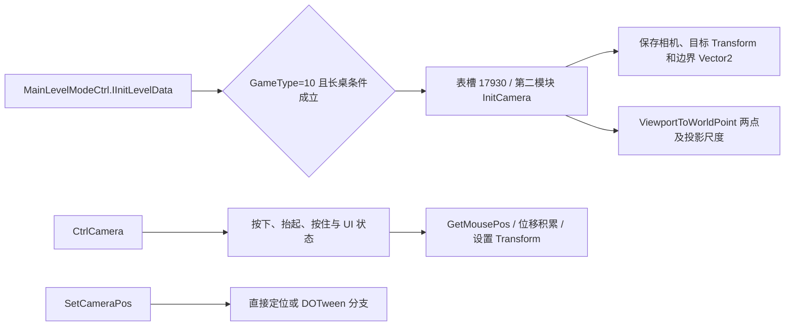

# 13 拆分模式调用链续查

更新：2026-10-24。主模块新增覆盖 588 个签名匹配入口、440 个独立函数体；第二 WASM 覆盖 128 个入口、126 个独立函数体。两组 Address 无重叠，共 716 个映射入口、566 个分模块独立函数体。该范围包含前一轮已读方法，不能称本轮净新增 716 个算法，也不代表每个方法语义已全部解释。

## 拆分表怎样连接

第二模块导入 `primary.table` 与内存，显式 elem 段将编译函数放到原表槽位。恢复工具流式读取两个大 WAT，保留各自类型签名并独立编译、验证选中分析模块。

新增 [constant-table-call-edges.json](evidence/2026-10-24-核心单局与运行配置/追踪/constant-table-call-edges.json) 只解析 **紧邻 call_indirect 前的常量槽位**，共 1,018 条调用点；没有把动态虚分派猜成直接调用。它是静态候选调用关系，仍需结合条件判断。

## 长桌模式已跨过的断点

第 09 章原先停在 `SpModeLongTableMa.IsCurModeLevel` 后的槽位 17930。这次在第二模块查到它对应 `InitCamera`（`$j37543`），签名包含 Camera、Transform、Vector2、float 及方法上下文，已与元数据核对。

InitCamera 中两次常量槽 50439 对应 `Camera.ViewportToWorldPoint`，随后计算差向量长度及角度相关比例。完整相机投影／坐标约定未执行，不把其中角度参数擅自命名成常规相机 FOV。

`HasMoveOverLimit` 原方法确认是拖动标志为真且累计值 **大于 0.2** 才返回真。`SetCameraPos` 保留目标 Transform 的当前 Y，采用输入的 X/Z；含 tween 与立即设置分支。CtrlCamera 的鼠标和 Time 调用已跨表定位，但触控桥接、所有状态交互和移动端最终阈值未重放。

## 双玩家高度访问

第二模块还解出了 LevelManager 的 SetMaxHeight、GetMaxHeight、GetMinTouchHeight。index=1 访问 260/264 字节字段，其他索引访问 324/328；与第一模块 SetMinTouchHeight 的两套字段一致。前沿和最大高度是不同字段，不能相互替代。

**【项目适配】** 自有 Unity 目前是单人固定俯视相机，未因此添加长桌横移或第二玩家；已经把共用生成与深度政策接入，避免无实际入口的模式外壳。核心单局的新增对齐详见第 15 章。

## 保留的未知部分

教学与棋盘模式在该共用初始化方法的默认出口，仍不能说明没有独立实现。PVP、赛季、无尽已知数据路由不等于服务器准备、续关和胜负全流程恢复。动态槽位、IL2CPP 泛型共享别名、事件回调与平台热更代理继续单独标识。分析模块的 WABT／JS 验证只证明类型与控制流有效，不会自动证明这些流程可独立运行。
