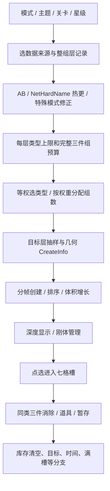

# 15 三消单局核心算法与调优

更新：2026-10-24。本章把**一局如何选配置、造库存、投放、遮挡、点选、消除、使用道具和判定结束**串成完整研究文档。覆盖完整研究范围，不等于所有线上行为已恢复。只对 402 样本的已读分支负责；缺证据的地方明确列出。

## 1. 当前项目的实质变化

默认配置已经从自有的 48／54／81 件切换到三种有来源的样本；不是只新增一份未使用的配置。入口为 [core-rounds.json](../unity/Assets/Resources/Data/core-rounds.json)，`GooseGame.BeginRound → CoreRoundCatalog.Create → LevelDefinition.MakeQueue → Spawn` 实际读取。

| 自有难度入口 | 来源样本 | 普通层预算／类型数 | 额外目标 | 时间 | 实际总量 |
| --- | --- | --- | --- | --- | ---: |
| 轻松 | Index=5，MainLevel，第 1 关 | 12 / 2 | 3 只同类目标鹅 | 0：自有入口不限时 | 15 |
| 标准 | Index=5，OneScreenBattle，第 1 关 | 30 / 6；30 / 3 | 无 | 120 秒 | 60 |
| 大师 | Index=5，MainLevel，第 2 关 | 150 / 21；60 / 10；45 / 8；45 / 7 | 无 | 首层 LimitTime[0]=600 秒 | 300 |

**【确认·资源】** 以上原始字段及完整层数来自同一 LevelData 表；[配置逐项核对](证据/2026-10-24-核心单局与运行配置/追踪/core-configuration-audit.json) 已验证自有配置中的层预算、源类型数、源高度、目标数及计时字段。150 只是首层，不能再把它写成整个主线第二关的数量。

**【项目适配】** 这是将三个来源原型映射到我们单人 UI 的选择，不是恢复了原版“轻松／标准／大师”进度体系；OneScreenBattle 的双人同步没有迁入。每主题现有 9 种模型，类型选择在实际生成时受现有候选数和组数限制；大师第一、二层不能达到原来的 21／10 种。不同模型尺寸、轮廓和识别难度也尚未等价。

当前核心档位取消单只金鹅加时／加分／赠道具、额外冰封、半程随机赠礼、自动解冻与额外“无解”判负。它们是原自有设计，已读经典样本不能支持其必要性。原配置保留用于旧视频／奖励回归测试，通过 `core-rounds.enabled=false` 才启用；新核心配置默认开启。

## 2. 证据链与配置优先级



主线配置并非只看一个 difficulty 数字。MainLevelModeCtrl 的来源路由见第 09、13 章；本轮公开 AB 和热更响应见第 12 章。已确认的本地默认与 CDN 值不能替代账号当前星级、AB 缓存、当前索引及加载完成状态。

Unity 的 core-rounds 提供可复现基线；level-tuning 仅接受显式自有覆盖，不联网请求竞品、不生成或假冒竞品账号分组。当前覆盖表为空，因此没有擅自选一个“更容易”的 AB 行。

## 3. 库存与类型选择

**【确认·静态】** 普通库存按层的 SumCount 换成完整三件组；AB ReduceGroup 按层减少组数。目标类型使用单独 WinType／WinCount，并按各层 WinTypeWeight 经 RealRandomRoll 分布，不能和普通类型入选概率混算。

普通候选来自 CanCreateType，空时有基于普通候选范围的回退。先以等权重加入 KFakeRandom，Roll 后删除已选项；**类型入选阶段不使用 OtherTypeWeight**。选好类型后才用它分配组数：

```text
for selectedType[0 .. N-2]:
    groups[i] = RoundToEven(float(totalGroups * weight[i] / sumSelectedWeights))
groups[N-1] = totalGroups - sum(previousGroups)
count[i] = groups[i] * 3
```

前后阶段各自有独立目的：类型选择控制本层混入什么；组数权重控制某类出现多少件；历史补偿选择控制连续选择的偏差。不能把它们统称为“按权重随机刷一个”。

**【项目适配】** 自有按层随机挑选候选子集，再分配完整组并构造有限队列；不再永远只取主题数组前 N 个类型。独立三件组预算不依赖 kinds×groups，因此热更改变类型数不会顺带改变整层物件总量。基础候选的无放回均匀抽样使用自有确定性 RNG；它不是原版 RNG 种子和完整 Roll/Check/Remove 生命周期的重放。

itemWeights 是投放顺序权重，groupWeights 是组数配额权重，均按实际候选 ID 映射；没有将烧烤原名权重强套到水果／数码模型。当前未配非等权主题时采用等量名义权重；非等权能力与零配额已测试。非法输入、全零回退及非负截断是项目防护，详见第 03、08 章。

## 4. 生成、刷新与分帧

**【确认·静态】** LoopCreateObj 根据层高度和场景边界构造 CreateInfo，排序后创建实际物件。普通分支使用场景 `_level2CreateCompeletTime=2`、`_frameMaxCreateCount=3`、`_maxCreateInterval≈0.03`；已读的等待间隔计算为：

```text
interval = min((2 / createInfoCount) * 3, 0.03)
```

300 件时为 0.02 秒；60 件及 15 件被封顶为 0.03 秒。协程内部按索引取模安排让帧，快生成接口分支可以跳过部分等待；不是无条件每件 0.03 秒。真实物理分支另用 3.5 秒、0.04 秒和每帧 3，且有物理窗口；样本 `_isUseRealPhysicSpace=0`，不能把这条路径当默认。

**【项目适配】** Unity 采用上述普通分支的批量间隔与批次大小，保留自己的起始让帧、落体、无重叠放置、格点抖动和旋转方式。源层高度 6／10／14 等保留在配置中，按自有 0.1 尺度加落点净空使用；它不是原几何体积采样的精确复刻。layer density 的 1.2／3.1／5.0 是自有适配参数。

“刷新”分成四件事：初始有限库存创建、层内剩余配额取出、物理下落暴露下层、道具打乱位置。本项目不会在完成三消后无限新增普通库存；移出／暂存／打乱保持总库存。尚未完成所有赛季／无尽增量生成分支，不能把这个结论推广到全部模式。

## 5. 深度承载与物理

**【确认·资源／静态】** 深度不是固定显示 70 件。样本可见深度 4–5，参考高度 21，刚体乘数 0.5，前沿单次最多下降 0.5。原始阈值为：

```text
r = Clamp01((reference - frontier) / reference)
threshold = frontier - Lerp(minDepth, maxDepth, r) * Min(multiplier, 1)
```

Unity 使用 0.4／0.5／2.1／0.05 的位置尺度，保留 0.5 乘数。下层 Renderer 和刚体状态分开管理。70 是配置预算，真实物理空间开关为 0，不能宣称恒定硬限额。

**【项目适配】** 自有 Collider 保留支撑，稳定等待、角速度、遮挡射线、迟滞、出场／扰动保护和移除后全体唤醒用于减少穿落和可见性闪动。300 件不是 300 个持续自由运动刚体；实际状态随堆叠而变，不能仅凭生成总量判断活跃物理数量。验收快照记录每主题 hidden、held、dynamicBodies 和阈值。

本轮还修正打乱放置：围绕 Collider 的世界中心夹紧边界，按阻挡物顶部寻找净空；之前按模型原点夹紧可能在旋转模型上反复撞墙。它是项目碰撞防护，不是恢复出的竞品算法。

## 6. 点选、七格和消除

**【确认·资源】** ContentPointList 主栏以及双人两套栏均有 7 个点位。**【确认·静态】** DelayToCheckContent 在合并处理之后再检查栏容量，计数达到点位数时进入失败准备；只剩一格有提示分支。GetTriple 转发模式接口，不是完整三消逻辑本身，不能只读这个短方法就声称恢复全部匹配。

Unity 保留同类相邻插入、凑三件消除、匹配第七件先释放槽位再判满、拒收第八件。隐藏件不能手动点选，自动验收／凑齐道具可绕过遮挡但不绕过库存规则。

**【待确认】** 原版输入选中偏移、动画延迟、旧／新动画系统切换、触控拖动与点击抑制并未逐帧重放。Unity 的立即槽位反馈、飞行动画缺口、音效和原始点选手感仍不同；单独列为体验差距，不能由规则测试代替人工验收。

## 7. 消耗道具与暂存

**【确认·资源／静态】** GameToolData 的 ToolReturnBack、ToolAutoFind、ToolMessUp，LimitCount 均为 1，FreeCount/BuyCount 均为 0。描述及已读 UseTool / CanUseTool 表明：移出 3 件到暂存栏；凑齐补足一种放置栏物体；打乱物品堆。CanUseTool 先检查可用次数，再处理空栏、空位不足、没有可消除物件等条件。暂存与“把三件丢回堆”的独立 ToolSLThrowBack 不是同一个道具。

Unity 核心档位新增独立 Stored 列表及 3 个可点击暂存图标，移出后不新造物件；点图标再按普通三消规则回槽。三种基础道具各限制一次成功使用。凑齐可处理暂存件，打乱不改变数量。旧自有直接丢回堆的移出仅保留在旧回归档。

**【项目适配／待确认】** 当前仍给每局每种 1 次体验额度；这不是竞品账号持有量，不能把 LimitCount=1 当成免费赠送 1 个。竞品账号的库存、广告、购买和远端工具包没有复刻；初始道具经济是明确缺口。GameToolData 的 ResumeAddTime.IntValue=5（描述单位分钟）用于自有核心档位的 300 秒补时，广告／账号是否有权使用仍由自有视频入口处理。

## 8. 胜负、时间与难度

MainLevelModeCtrl 的 IIsUseTargetCondition 在普通主线为 false，部分无尽／赛季子模式为 true。CheckLevelState 在非目标分支检查 `_boxObjList`；目标分支检查目标计数。Unity 当前三个档位均按有限库存完整清空获胜，三只入门鹅是普通可三消的一组，不是点一次奖励 20 秒的单只金鹅。

IGetLevelMaxTime 的普通分支读第一条层记录 LimitTime[0]，联网、PVP、组队有独立入口。不能把 `[600,900,0]` 同时当三层倒计时。0 值在自有入门入口按不限时处理；原版强制教学及完整计时启动 gate 仍未逐帧验证。

难度由类型混杂、稀有组配额、总库存、几何遮挡、承载深度、时间压力和可用道具共同决定。单纯把物件从 81 增到 300 不会自动得到同等难度：当前 9 类模型、等量名义配额、不同碰撞与自有随机数使主线仍可能更容易。没有证据证明“槽位占用触发动态改牌”，不新增此类干预。自有固定重试种子也不称为原版必可解保证。

## 9. 已做验证与判断边界

最新验证汇总见[本轮证据](证据/2026-10-24-核心单局与运行配置/验证汇总.json)。已完成 2,500 个原 AB 桶场景及解析／缓存边界、104,031 项生产 C# 检查、14 项 Unity 编辑测试，以及 132 项实际开发包运行检查；覆盖五主题 300 件深堆、分层数量、库存守恒、暂存取回、道具上限、清盘、隐藏支撑及唤醒。旧打乱失败和修复后成功记录分别保留。

这些检查不证明原版整局二进制重放、自动可解、同等胜率、目标手机帧率或微信发布通过。完整原版 CreateLevel 与联网模式没有整体执行。渲染截图另行记录，不和 headless PhysX 验收混成同一种证据。

另一次实际 Windows 开发包以离屏相机绘制原场景和原 HUD，完成 11 项渲染／文件检查，并人工查看[首页](证据/2026-10-24-核心单局与运行配置/画面/core-home.png)、[入门](证据/2026-10-24-核心单局与运行配置/画面/core-0.png)、[标准及暂存栏](证据/2026-10-24-核心单局与运行配置/画面/core-1.png)、[300 件深堆](证据/2026-10-24-核心单局与运行配置/画面/core-2.png)。隐藏窗口最初的 swapchain 截图全黑，已判为无效，未作为画面通过证据。当前 Windows 可玩包也已成功重建；微信／手机包未以此宣称同步通过。

## 10. 复刻缺口与下一步验收条件

| 项目 | 当前状态 | 达到更接近复刻所需证据／工作 |
| --- | --- | --- |
| 层预算、目标数和计时字段 | 三个样本已进入实际生成 | 当前账号最终选择及更多主线样本 |
| 类型数与组数权重 | 已分阶段，类型受自有模型池限制 | 每主题扩到足够可识别物品；建立权重语义对应 |
| AB／热更 | 默认及此次公开响应已确认，显式本地覆盖可用 | 运行时分组与最终层记录，不猜账号桶 |
| 几何生成与承载 | 深度公式及分帧间隔对齐；落体为适配 | 原场景边界／体积采样和目标设备视觉对照 |
| 三消、暂存、基础工具 | 规则与上限已接入 | 原动画、排序时序、工具回调完整重放 |
| 难度与胜率 | 300 件库存、时间和规则可复现 | 相同策略的多种子完成率、人工通关时长与真机性能 |
| 模型风格 | 49 件参考含 5 件烘焙蒙皮姿态 | 自有原创资源制作、原 Shader 近似和模型差异测量 |

因此本轮可表述为“已按竞品证据实调核心单局，完整记录算法链与复刻差距”；不能表述为“原版所有核心算法与体验已经一比一复刻”。
