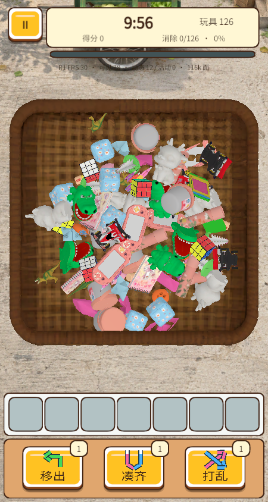

# 21 · iPhone 持续卡顿与玩具对照

后续比例修正 **R2** 见[第 22 章](22-场景与物件占屏比例修正.md)：公共基础尺度和相机／铺放范围已再次调整。下文 0.45 玩具尺度、截图和统计仅代表本章 R1 冻结版本；不能用于当前包比例或性能结论。

更新：2026-10-24。交付标识：`20261024-R1`。用户设备：iPhone 15 Pro，反馈为物堆静止后仍持续卡顿；系统版本未提供。本章接续第 17、20 章，旧版性能数据保留为历史证据。

## 1. 结论与证据边界

**【确认·项目代码／资源】** 问题同时涉及渲染提交、物理唤醒、遮挡查询和部分高面数模型。原逻辑每次移除会释放整堆深度保持，300 件库存点击后可有 299 个动态刚体。农场 300 件的未裁剪材质槽位为 1,002，三角形为 835,542；单靠延迟加载无法解决持续运行成本。

**【观察】** 用户提供的竞品截图中，长条油条、小烧卖、扁片胡萝卜和大蒸笼具有明显的体积与轮廓差异，物件覆盖了较大的游戏区域。我们的统一归一化尺寸削弱了这种区别。本轮加入尺寸档和相机调整。截图属于食物主题，不能据此认定玩具主题、总库存、真实面数或实时帧率；蒸笼内多个包子也不能直接当作多个独立刚体。

**【项目适配】** 优化保留正式五主题的 15／60／300 件库存与既有权重；增加独立的 21 类玩具 126／300 件对照关，便于同一台手机比较物件数量。并未将竞品资源替换进正式主题。

**【待确认·真机】** 当前没有连接这台 iPhone，不能宣称真机卡顿已消失。本轮数据来自 Unity Windows 开发包强制移动档和实际导出的微信文件；桌面限帧 30 不是 iPhone 达到 30 FPS 的证据。开发包测试存在并行执行，帧耗时也不能用作隔离的优化前后提速比例。

## 2. 竞品实际代码与序列化值

### 2.1 已确认

- **【确认·资源】** 冻结 402 data 的 `globalgamemanagers`／TimeManager／pathID 8：`Fixed Timestep≈0.02`，即默认 50 Hz；最大允许时间步约 0.333333。原文件 SHA-256 与完整 PhysicsManager、QualitySettings 读值见证据中的 `competitor-time-physics.json`。这些是包内值，不能证明账号运行时未被覆盖。
- **【确认·静态】** 已恢复的 `GetObjSize` 常规返回路径为 1，Season 模式 9 转入 `SeasonLevelMa.GetSizeData`，GM 模式 6 另有分支。仅凭此方法不能支持“所有物件统一按最长边再次归一”的说法；也不能推导所有模式实际尺寸。方法体为 `j43536.annotated.wat`，原调用链见第 13、20 章。
- **【确认·资源／静态】** 已恢复深度配置与刚体管理方法存在显示深度、刚体深度倍率和约 70 的软预算；普通模式可以具有 300 件库存。详细参数出处见第 04、08、15 章，不能将 70 当成总库存，或将 300 当成必然错误。
- **【确认·资源】** 复用已提取的 27 件静态玩具中的 21 件；每件保留来源模型、贴图及原始提取记录。不是重新设计的替代模型。逐件来源和处理结果见 [21A](21A-移动模型与玩具资源清单.md)。

### 2.2 本轮不能确认的内容

**【推测／待确认】** 截图对应账号的 AB 分桶、热更最终覆盖、实际库存、可见数、运行中的物理频率和真实 Draw Call 未取得；没有从截图倒推出这些值。提取的材质仍不能完整还原原 Toon／MatCap／透明渲染，当前参考关复用几何和基础颜色纹理，不能称为竞品画面的完整复刻。

## 3. 渲染与模型差异，及本轮处理

以下为 Unity 实际导入后的模型审计，按现行三档中 300 件配额求和，**不含静态容器／UI／背景**。材质槽位是未裁剪的 renderer／submesh 提交槽位，**不是实测 GPU Draw Call**。同材质实例可能合批，遮挡又会减少可见数量。

| 主题 | 原三角形 | R1 三角形 | 原槽位 | R1 槽位 |
| --- | ---: | ---: | ---: | ---: |
| 水果 | 458,916 | 458,916 | 624 | 300 |
| 古玩 | 639,384 | 530,190 | 942 | 300 |
| 农场 | 835,542 | 553,800 | 1,002 | 300 |
| 甜品 | 472,602 | 460,338 | 588 | 300 |
| 数码 | 483,924 | 483,924 | 300 | 300 |

**【项目适配】** 普通物件合并为单网格、单 Renderer、单材质，利用原 UV 与颜色／纹理图集保留外观。只对超过预算的普通物件减面：Unity 原玉玺 19,528 面 → 3,144，玉米 6,576 → 2,994，青蛙 8,128 → 3,000，鸭子 5,860 → 3,999；最终普通物件均不超过 4,000 面。水果和数码的主要收益是提交或物理管理，不虚报面数下降。

**【项目适配】** 静态编织篮保留 25,000 面外观，没有为了普通物件预算破坏篮纹。容器不是上百个动态复制体，应分开衡量；接触碰撞另建低面模型，五个容器碰撞均不超过 450 面。农场使用 24 边开放内碗近似，独立根节点对齐 bounds，避免 FBX 根单位比例造成碰撞错位；其细节并非真实篮子镂空碰撞。

**【项目适配】** 手机运行时在凸包已独立烘焙的前提下释放普通渲染网格的 CPU 副本；容器不走这条释放路径。取消空槽位时的额外 3D 叠加相机渲染。微信 iOS 导出代码此前已有 `devicePixelRatio=1.5`，本轮没有以“从 3 降到 1.5”为收益依据；实际 Screen 宽高由 R1 设备日志采集。

## 4. 物理、遮挡和点击后的成本

**【确认·项目问题】** 原先 70 个动态刚体预算只用于记录超额，未改变高度阈值；移除时又唤醒整堆，深度优化难以在持续点击中起效。

**【项目适配】** R1 做了以下修改：

1. 用高度排序的第 70 件辅助提高刚体阈值，保持运动速度、静止时长、刚生成与局部扰动保护。它是软预算，运动中的物件仍可超过 70，不会为了数字强制冻结半空物件。
2. 普通移除只唤醒其水平邻域／支撑列，半径取 `max(0.55, rootScale×1.8)`，局部保护最多 0.25 秒；打乱仍可整堆唤醒。移除不强行显示所有隐藏物件，避免点击后瞬间增加渲染量。
3. 遮挡支撑代理从 5 条射线改为 3 条，缓存 0.20 秒，局部移除失效；所有活动物件睡眠后深度刷新间隔至少 0.30 秒。孤立深处物件仍须通过遮挡保护，保留碰撞支撑。
4. 物理从本项目原 60 Hz 调为 30 Hz，最大追赶时间 1/15 秒，移动档采用 `ContinuousSpeculative`，求解迭代保持 6／2。**竞品包内默认是 50 Hz；30 Hz 属于我们针对移动端的选择。**
5. 微信 SDK 初始化后调用 `SetPreferredFramesPerSecond(30)`，与 Unity 限帧一致。开局隐藏稳定／自底逐层出现和真实 3D 飞入栏位保留；完成出场后直接进入深度管理，不再次整堆释放长保护。

强制移动档开发包的真实场景结构采样如下。每个主题只取本次一个种子，不能外推全关卡；三角形不含容器等固定开销。

| 场景 | 原静止可见／槽位／面 | R1 静止可见／槽位／面 | 原点击后动态 | R1 点击后动态 |
| --- | --- | --- | ---: | ---: |
| 水果 300 | 147／273／231,748 | 120／120／185,644 | 299 | 42 |
| 农场 300 | 159／583／527,928 | 108／108／208,734 | 299 | 79 |
| 数码 300 | 146／146／239,364 | 132／132／220,588 | 299 | 46 |
| 玩具 126 | 无 | 78／78／115,864 | 无 | 54 |
| 玩具 300 | 无 | 99／99／165,774 | 无 | 93 |

79／93 超过 70 是运动与扰动保护生效的结果。`dynamicBodies` 表示非 kinematic，包含已睡眠者；`awakeBodies` 才表示其中未睡眠的数量。隐藏窗口的 ProfilerRecorder 部分渲染计数为 0 或不可用，故不用这些值宣称 Draw Call 或 GPU 时间改善。

## 5. 大小辨识与玩具对照关

**【项目适配】** 原最长边统一归一只解决资产单位，不能单独代表视觉大小。新增 `item-presentation.json` 叠加尺寸档，例如西瓜／蓝莓、收音机／U 盘分别放大与缩小，并保留原 scaleAdjust；相机可视区扩大以减少上下留白。形状、遮挡和选取体验仍需手机观察，不能靠比例表保证所有物件可辨。

玩具参考尺寸取提取模型作者尺度的最长边，相对该批中位数缩放，限制在 0.65～1.55。**这是恢复大小差异的项目映射，不是还原竞品运行尺寸。** 两个对照关均用基础 `itemScale=0.45`，只切换库存：

- 126 件：21 类各 6 件；300 件：21 类各 12／15 件，均为完整三件组。
- 两关都实际装载 21 类基础纹理和几何，使用同一农场容器与项目光照。
- 单层、600 秒，无金鹅／冰封／额外目标；配额为本项目平衡对照值，不能称为竞品实际权重或关卡。
- 首页左上 **“对照” → “玩具 126”／“玩具 300”**。该入口不消耗正式尝试次数，不推进五主题存档关卡；返回首页后恢复正式主题。

**【观察·实际开发包截图】** 两档均能出现长短、大小有别的玩具；基础纹理已恢复。300 件仍较密，126 件用于检验减少库存对持续帧率和辨识的影响。不能只凭截图选定正式库存。

## 6. 资源处理与排错经验

**【确认·处理记录】** 本轮候选共 60 件：39 件自有复杂物件／容器，21 件静态参考玩具。原模型、旧材质纹理与 meta 归档到 `projects/catch-big-goose-unity/SourceAssets/MobileBaseline-20261024`，保留既有 FBX GUID；未处理的简单自有模型不重复转换。参考源留在 `reference-projects/competitor-goose/2026-10-23`，不修改已有提取哈希清单。

中间两种外观不合格结果没有交付：智能展开 UV／烘焙造成篮底黑块及边缘渗色，改回原 UV 采样图集；Blender 延迟图像的 `has_data=false` 被误判为缺贴图，造成参考玩具全白，改为从源文件路径／packed bytes 读取。自有管线 v5、参考 v6 为本轮有效结果。`final-*` 为中间目录名称，不能据名称认作当前交付；**当前仅 `delivery-*` 与本章证据归档代表 R1**。

候选经历 GLB 回读、四视图及 192／64 像素图标生成。60/60 GLB 通过官方格式校验，无 error／warning；普通物件单网格／单材质预算、容器接触网格预算和大小比例另由 Unity 编辑测试验证。候选的四视图输出不等同于竞品原着色器匹配证明。

## 7. 本轮验收与微信交付

| 检查 | 结果 | 范围 |
| --- | --- | --- |
| Unity 编辑测试 | 21/21 | 规则、普通模型预算、接触网格、大小差异 |
| 算法开发包 | 132 项通过 | 深度、有限库存、库存守恒等；该套快捷点选不是动画证据 |
| 交互开发包 | 60 项通过 | 正常 3D 飞入、挤位、聚拢、底层逐层出现 |
| 正式五主题 | 15/15 局通关，0 越界 | 每主题 15／60／300 件，正常动画，可见射线策略，6 倍测试时间 |
| 玩具对照 | 2/2 局通关，0 越界 | 126／300 件，正常动画，同样的可见策略 |
| 场景结构采样 | 10 行完成 | 三正式主题、两玩具库存，静止及点击后各一行 |
| GLB 候选 | 60/60 | 60 件各四视图输出，格式校验零错误／警告 |
| 微信导出审计 | 通过 | 29.18 MiB，61 个 JS 语法检查，资源／视频／字体完整性 |

这些脚本会按可见候选和栏位状态择优，**不是人工难度体验或竞品通关率**。本次未重跑第 15 章独立 WASM 数值大样本，不将历史项数冒充 R1 新增验收。

当前微信工程：`builds/catch-big-goose-wechat`，自有 AppID 不变。需在微信开发者工具中对这个新导出目录重新预览，手机确认左上“对照”弹窗为 **R1**；玩具关默认显示性能行，正式关可 **暂停 → 性能数据 → 继续游戏**。日志 `[GooseDevice]` 每秒记录 BuildId、屏幕尺寸、FPS／P95、可见数、材质槽位、三角形、动态与活动刚体；帧环缓存固定 120 项，避免无限增长。

本轮调用 `open-wechat.ps1` 自动打开工程仍被开发者工具自身的 `TypeError: d.on is not a function (code 10)` 阻断；Unity 编译和本地包审计已完成，但未生成 R1 新二维码。需在已登录的开发者工具中手动打开上述目录，点击顶部预览；不沿用旧 `iphone-preview-qr.png`。原始错误日志随本轮归档，不能将旧模拟器或旧二维码的成功记录当作 R1 成功。

先比较两档玩具在静止、连续点击、三消过程的 FPS／P95 与活动数，再与正式农场 300 件比较。若静止仍慢且活动刚体接近 0，继续查渲染／分辨率／WebGL 主线程；若活动数长期偏高，查接触抖动和支撑。**这是下一轮实测判别办法，不是已取得的 iPhone 结果。**

原始报告、当前源码／配置、原图、实际截图、包审计、来源哈希及资源表收录在 [本轮证据](../../competitor-analysis/evidence/2026-10-24-iPhone持续卡顿与玩具对照/验证汇总.json)。归档校验工具同时比对当前交付源码及导出文件，避免将中间结果误作最终包。
