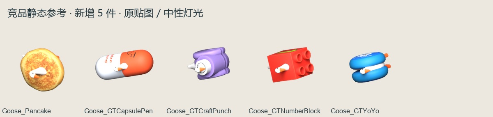
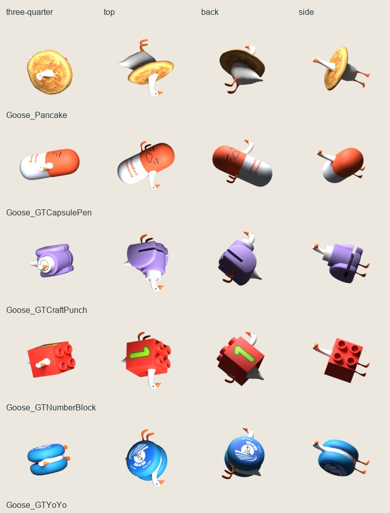

# 蒙皮大鹅：预制体姿态参考

提取日期 2026-10-23，整理日期 2026-10-24。五件参考均由本地缓存只读恢复；用途为轮廓、贴图和生成参考，没有进入 Unity 正式资源。

| 模型 | 三角数 | 骨骼数 |
| --- | ---: | ---: |
| Goose_Pancake | 2,402 | 21 |
| Goose_GTCapsulePen | 2,952 | 21 |
| Goose_GTCraftPunch | 2,502 | 21 |
| Goose_GTNumberBlock | 3,440 | 21 |
| Goose_GTYoYo | 3,320 | 21 |

每件位于 models/对应名称/，包含 `.blend/.glb/.obj`、材质、原贴图、source.json、source-pose.json、three-quarter/top/back/side 四视图及 icon-192/icon-64。使用单件 three-quarter.png 作为生成输入；多视图总览用于人工审阅。

source-pose.json 保存骨骼父子、本地 TRS、世界矩阵、原位置／法线、权重／索引及绑定矩阵。顶点按骨骼姿态烘焙，导出的三维文件为静态参考，不能直接播放原动画。原 Shader 以基础色/PBR 近似。

五件 GLB 回读后三角数及尺寸一致、UV 存在；Khronos 验证均为 0 错误、0 警告。实际查看四视图，颈部、身体、双脚和外部物件姿态正常。没有运行动画、碰撞、Unity 正式导入或手机性能验收。

恢复方法和范围见[第 14 章](../../../竞品分析/14-蒙皮大鹅姿态恢复.md)。来源哈希见 manifest.json；导出检查见 export-verification.json、gltf-validation.json；视觉记录见 visual-review.json。
