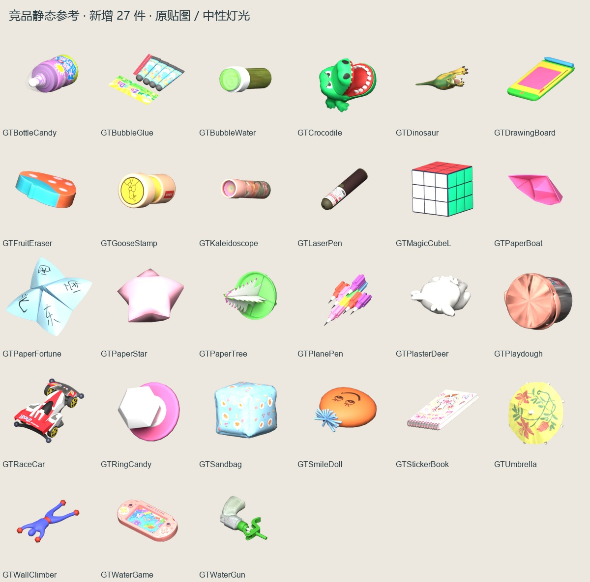

# 童年玩具 · 模型生成参考

2026-10-23 从用户指定竞品的本机缓存新增提取 27 个静态物件。与 [上一批 17 个烧烤模型](../2026-10-22/README.md) 合计 44 个静态参考。文件独立存放，用于本地风格研究，没有进入 Unity／Cocos 正式资源。

每个 `models/<ID>/` 包含 Blender、GLB、OBJ/MTL、源贴图、完整 source.json、四幅 256px 视图、192px 和 64px RGBA 单物件图。原始网格／材质／UV／变换／碰撞记录保留；仅移除根平移，不归一化原尺寸。

- [四视图 1](multiview-1.jpg)、[四视图 2](multiview-2.jpg)、[四视图 3](multiview-3.jpg)：已实际查看。
- [来源与模型清单](manifest.json)：源 bundle 的大小、SHA-256 与模型索引；27 件源三角数 126–3,104，中位数 1,664。
- [导出回读验证](export-verification.json)：三角数、UV 和尺寸检查通过。
- [Khronos 校验](gltf-validation.json)：27 个 GLB 零错误、零警告。
- [文件校验](文件校验.json)：完整交付文件的大小与 SHA-256。
- [如何用于生成参考](../../../竞品分析/10-模型提取与生成参考.md)：辨识特征、单物件输入建议与限制。

预览以源颜色贴图和中性灯光展示，不是原 Shader 复刻。ToonGlass 按原 `_BaseTint.a` 做 PBR 透明度近似，以免包装和透明外壳变成白色遮挡；反射、折射与多 MatCap 效果仍不同。GTBubbleGlue 包装可能几乎不可见，石膏鹿的白色为源风格。薄折纸保持原网格，不承诺可直接用作动态碰撞体。

Goose_GTCapsulePen、Goose_GTCraftPunch、Goose_GTNumberBlock、Goose_GTYoYo 含蒙皮，未恢复姿态，已在 manifest 中标为跳过；没有伪造其静态模型。提取未执行竞品启动脚本或修改缓存。原图案和标签仅作原始参考，生成自有候选时独立制作几何与贴图。
